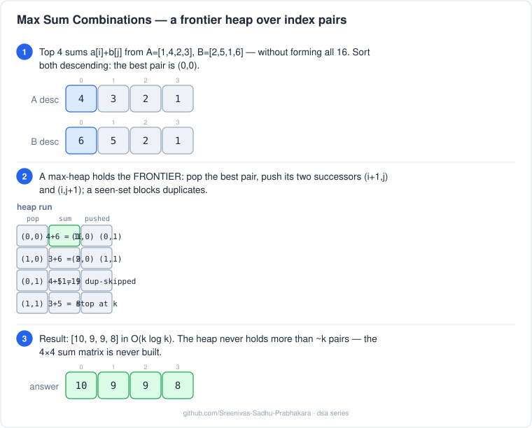

# Maximum Sum Combinations

> Striver SDE Sheet 071 · Day 12 Heaps — best-first search over the pair grid with a max-heap frontier; only k cells ever materialize. Go, stdlib only, tested.

## Problem

Given two arrays, the k largest values among all n·m pairwise sums a[i]+b[j] — without computing all n·m sums (k is tiny compared to the grid).

## Approach

Sort both arrays descending. The grid of sums is now non-increasing along every row and column, so the k largest sums live in a staircase region reachable from cell (0,0). Explore best-first: pop the largest frontier cell from a max-heap, emit it, and push its right and down neighbors. A seen-set stops the two paths into each cell (from above and from the left) from double-inserting it. Exactly k pops, at most 2k pushes — the other millions of sums are never formed. This frontier pattern is the same one behind "k smallest pairs" and "k-th smallest in a sorted matrix".

**Complexity:** O((n+m) log + k log k) — effectively O(k log k) after the sorts.

## Visual walkthrough

Read the picture top to bottom — each numbered frame is one moment of the algorithm
running on this repo's test example.

## Run

    go test ./...   # verify
    go run .        # demo

---

One of 191 repos solving Striver's SDE Sheet in Go — stdlib only, one problem per repo, every solution tested. Browse the set: [`dsa-*` repos](https://github.com/Sreenivas-Sadhu-Prabhakara?tab=repositories&q=dsa-&type=source).
